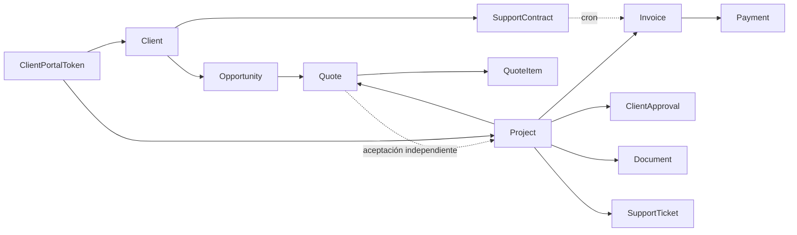

# Auditoría comercial — 2026-10-16

Base verificada con `git ls-remote origin refs/heads/main`: `598822865f6c63f389247a0f7be55d60e19c6875`. Checkout independiente `NoteCode-commercial`, rama `refactor/flujo-comercial-unificado`. Se conserva el checkout original y sus archivos sin seguimiento. No se usan credenciales ni datos de producción.

## Etapa A: mapa y diagnóstico previo a cambios

Se inspeccionó el esquema completo (incluidos impuestos, notas, workspace, asistente y SEO), rutas de proyectos/ERP/portal/facturas, automatizaciones, escrituras de Gilberto, componentes comerciales, navegación y pruebas. No existen server actions comerciales: las acciones relevantes usan rutas y herramientas del asistente.

`Quote.parentQuoteId/version` ya permite representar revisiones, pero no protege sus operaciones. `ClientApproval` sirve para entregables, no identifica una versión de propuesta. `TaxDocument` y F29 ya son distintos de `Invoice`. `ProjectMilestone` representa ejecución, no obligaciones de pago. `SupportContract` ya posee calendario recurrente. Documentos, tareas y requisitos tienen `clientVisible`; no necesitan duplicarse. Los proyectos personales requieren aislamiento y no participan del circuito comercial.

| Severidad | Archivo / operación | Evidencia, causa e impacto comprobado | Solución |
|---|---|---|---|
| Crítica | `lib/projects.ts`, `syncProjectInvoice` | Upsert actualiza cliente/importes sin consultar pagos; completar proyecto dispara facturación. Una aprobación posterior cambia historial. | Eliminar la sincronización monetaria implícita; emisión explícita idempotente por hito; protección transaccional y SQL. |
| Crítica | `app/api/portal/[token]/route.ts` GET | `include` devuelve propuestas completas con `notes`, facturas con notas y pagos con referencias/notas internas. | DTO público por selección positiva, compartido con impresión. |
| Alta | `app/portal/[token]/cotizaciones/[quoteId]/page.tsx` | Omite `access.projectId`; un token de proyecto puede leer otra propuesta del mismo cliente. | Resolver token y alcance en servicio común; verificar cliente/proyecto activo y COMPANY. |
| Alta | `app/api/erp/[resource]/[id]/route.ts`, convert | Cada solicitud crea proyecto; no transacción ni vínculo de oportunidad único. Convertir cotización también la aprueba implícitamente. | Bloqueo de raíz comercial, conversión de versión aceptada, reutilizar asociación; transacción atómica. |
| Alta | misma ruta, quotes PATCH | Permite cambiar contenido aprobado, estados arbitrarios, versiones antiguas y borrar líneas. Envío y sustitución ocurren fuera de transacción. | Estado explícito; contenido publicado inmutable; revisión nueva; serialización por familia y proyecto. |
| Alta | portal POST decide-quote | Cualquier decisión distinta de Aprobada se convierte en Rechazada. No compara versión/contenido, ni deja evidencia separada. | Decisión tipada + hash visualizado, auditoría y acuerdo en una transacción. |
| Alta | `app/api/invoices/[id]/route.ts` | PATCH puede alterar importe, impuestos, cliente y estado pagado; DELETE oculta registros cobrados. | Servicio financiero común y bloqueo del registro con pagos; estado derivado de pagos. |
| Alta | ERP payments, Gilberto registrarPago | Pagos fuera de transacción; sin límite de saldo, moneda ni idempotencia; DELETE elimina evidencia. | Clave de solicitud, bloqueo de factura, validación del saldo y pagos inmutables. |
| Alta | `lib/ai/tools.ts` | Escribe propuestas, estados, facturas y pagos directamente, saltándose las rutas. | Reutilizar servicios de dominio; extraer adaptadores comerciales con utilidad concreta. |
| Media | `lib/commercial.ts`, QuoteDocument, ClientPortal, ProjectCommercial, ERP, AI | Fórmulas repetidas sobre Float, sin política común de redondeo. | Cálculo compartido con enteros por unidad monetaria; política versionada para históricos. |
| Media | `components/ProjectCommercial.tsx` | La primera línea nace vacía pese al precio del proyecto; faltan alcance/condiciones. | Precarga del servidor para ambas entradas; no inventar desglose ni tratamiento tributario antiguo. |
| Media | automatización recurrente | Avanza calendario separado del upsert; concurrentes pueden saltar periodos. Número usa mes de ejecución y no periodo contractual. | Transacción bloqueando contrato y referencia estable del periodo; conservar motor único. |
| Media | consultas de proyecto/reportes/ERP | Incluyen facturas borradas/canceladas en algunos totales y usan ingreso bruto con costos netos. | Consolidar resumen económico; explicitar neto/bruto y saldos. |

Riesgos potenciales (no incidentes observados): colisión de numeración por `count()+1`; filtración de proyectos personales mediante relaciones ERP; purga de proyecto con cascada sobre aprobaciones/portal; pérdida de auditoría por fallos entre escrituras; costo real de horas calculado con tarifa actual del miembro, sin captura histórica. Este último necesita una decisión de contabilidad de costos separada.

Navegación: la ficha ya tiene General, Comercial, Operación, tareas, requisitos, documentos y notas. Se conserva esta organización y el scroll horizontal móvil; se añaden cobros, acuerdo, comentarios y administración del portal dentro de Comercial. Las vistas globales continúan disponibles. La verificación de navegador se registra al final, no se presume realizada por inspección del JSX.

Pruebas iniciales ejecutadas: `npm test`: 27 archivos, 86 pruebas, todas aprobadas. No había integración comercial ni Playwright. `lint` es actualmente un alias de TypeScript (no ESLint); se documentará por separado.

## Etapa B: diseño y contratos

| Dato | Responsable |
|---|---|
| Valor estimado | Opportunity.value, nunca acuerdo |
| Precio inicial neto / IVA explícito / condiciones | Project.saleNetAmount/saleTaxRate/commercialTerms |
| Precio propuesto, alcance, impuestos, términos, plan | Quote + QuoteItem, versión publicada inmutable |
| Precio aceptado | CommercialAgreement, único por Quote, captura exacta de aceptación |
| Project.agreedAmount | Compatibilidad histórica; para nuevas aceptaciones refleja total del acuerdo actual |
| Costos / horas presupuestados | Project.budgetCost/budgetHours, exclusivamente internos |
| Costos reales | TimeEntry + Expense (limitación histórica de tarifa indicada arriba) |
| Facturado | Invoice: registro operativo histórico, no emisión SII |
| Cobrado / saldo | Payment y diferencia con Invoice.amount |
| Visibilidad | Registros originales + filtros de portal; nunca copias de negocio |

Estados: Borrador → Enviada → Aprobada / Cambios solicitados / Rechazada / Vencida / Reemplazada. Una revisión es otro Quote bajo la misma raíz. Al publicarla se reemplazan versiones pendientes anteriores; las aceptadas permanecen aprobadas e inmutables. No se puede aceptar una versión anterior a la última publicada. Cada decisión exige el hash del contenido visualizado y registra actor, origen, fecha, observaciones y token (identificador, nunca secreto). La aceptación en portal es evidencia de decisión, no firma electrónica legal.

Dinero nuevo: CLP entero; USD/EUR con dos decimales preparados. Operaciones intermedias con BigInt, redondeo half-up por línea, descuento y tributo; almacenamiento de acuerdos/hitos Decimal. Columnas Float existentes se mantienen para no convertir históricos. `calculationVersion=0` conserva cálculo histórico; versión 1 usa política nueva. Un proyecto sin neto explícito no genera automáticamente un desglose tributario.

Concurrencia: transacciones y bloqueo de fila de raíz/proyecto/factura/contrato; índice único de acuerdo por propuesta, hito por acuerdo/posición, factura por hito y clave de pago. Convertir no acepta implícitamente. Propuestas de una oportunidad reutilizan el proyecto asociado. Una propuesta aceptada puede vincularse a un proyecto existente del mismo cliente.

Cobranza: plan único por defecto; anticipo/saldo o hitos porcentuales definidos antes de publicar. Aprobar establece hitos sin emitir facturas. Emisión explícita por hito, reintentos devuelven el mismo documento. Los contratos conservan su motor periódico. Una nueva aceptación no modifica facturas previas y requiere conciliar los cobros existentes antes de planificar un saldo adicional; nunca se vuelve a facturar automáticamente el total ya cobrado.

Migración: SQL manual aditivo, conforme al patrón existente. No backfill que deduzca IVA, aceptación ni relaciones ambiguas. Índices nuevos solo sobre campos nuevos; triggers para preservar facturas cobradas y evidencia. Se prueba esquema anterior → migración, backup → restore en PostgreSQL local aislado. No se aplica a producción.

Suposiciones reversibles: todos los nuevos documentos financieros son internos; no se envían correos, no se crean DTE, no se cargan pagos reales; crear hitos no ejecuta cobros. Una corrección de pago exige un procedimiento contable explícito, no borrar el pago.
