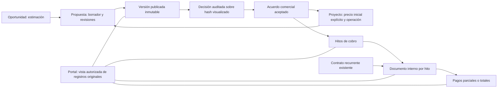

# Flujo comercial unificado — informe de entrega

> Informe de la entrega anterior, cerrada en `e0c32cd`. La revisión correctiva, validaciones actuales y condiciones de merge están en [FLUJO-COMERCIAL-REVISION-CORRECTIVA.md](FLUJO-COMERCIAL-REVISION-CORRECTIVA.md).

Fecha: 2026-10-16. Rama: `refactor/flujo-comercial-unificado`. Base remota comprobada: `598822865f6c63f389247a0f7be55d60e19c6875`. Checkout: `C:/Users/diego/Desktop/NoteCode-commercial`.

La implementación reúne proyecto, propuesta, decisión del cliente, acuerdo y cobros en un proceso compartido. No hubo merge, PR, despliegue, envío de correos, cobros reales ni acceso a producción. El checkout original sigue en `feature/seo-module` y conserva sus tres scripts sin seguimiento. `main` se mantuvo intacta.

La auditoría inicial con evidencia, causas, impacto, severidad y decisiones se conserva en [FLUJO-COMERCIAL-AUDITORIA.md](FLUJO-COMERCIAL-AUDITORIA.md). La operación de migración y compatibilidad está en [FLUJO-COMERCIAL-MIGRACION.md](FLUJO-COMERCIAL-MIGRACION.md).

## Hallazgos confirmados y resolución

| Problema | Resultado |
|---|---|
| Completar proyecto emitía/recalculaba facturas y podía alterar documentos cobrados | Los cambios operativos no emiten ni revalorizan documentos. `syncProjectInvoice` queda como adaptador de compatibilidad sin efectos financieros. La emisión es explícita, por hito y con origen único. |
| Convertir oportunidad/cotización creaba proyectos por cada solicitud y aceptaba implícitamente | Conversión transaccional de versión aceptada; bloqueos y reintentos, asociación de oportunidad y reutilización del proyecto. Puede vincularse uno existente del mismo cliente. |
| Propuestas aprobadas y publicadas editables | Contenido, cliente capturado, alcance, condiciones, plan y precios publicados quedan inmutables. La edición exige otra revisión. |
| Versiones antiguas podían sobrescribir acuerdos posteriores | Se verifica raíz, versión y publicación respecto del acuerdo actual. Las aceptaciones antiguas siguen disponibles. |
| Solicitar cambios equivalía a rechazar | Estado propio, observación separada y revisión posterior; rechazo continúa como decisión distinta. |
| Decisiones simultáneas podían contradecirse | Decisión, auditoría, acuerdo y preparación de hitos en la misma transacción; hash de contenido visualizado; reintento sin efectos repetidos. |
| Portal devolvía notas de propuestas, facturas y pagos | Selección positiva de campos públicos. No incluye notas internas, costos, márgenes, credenciales, tarifas ni información de otros clientes. |
| Documento imprimible omitía el alcance por proyecto del token | Resolución y filtro comunes en API e impresión, incluida revocación, vencimiento, cliente y proyecto activo de empresa. |
| Un borrador reemplazado podía confundirse con algo publicado | El portal exige evidencia de publicación; un borrador nunca publicado sigue siendo interno aunque otra versión lo sustituya. |
| Pagos sin límite, sin idempotencia y con borrado de evidencia | Clave de solicitud, moneda y saldo validados bajo bloqueo de factura. Pagos inmutables. Documentos cobrados no cambian precio, impuestos, cliente, identidad ni origen. |
| PATCH aplicaba valores por defecto a campos omitidos | Validaciones separadas para creación/edición. Se preservan IVA cero, descuento, moneda, plan, estado y origen cuando no se envían. |
| Fórmulas divergentes, IVA inferido y margen bruto contra costos | Cálculo compartido y versionado. Neto histórico desconocido se muestra por conciliar; margen sobre neto aceptado. Costos y presupuesto interno siguen separados del precio de venta. |
| Finanzas ignoraba el filtro del proyecto y ocultaba errores HTTP | Filtro efectivo y mensajes de rechazo visibles. Los pagos parciales participan del cobrado; no se marcan documentos pagados sin registrar un pago. |
| Asistente y cron saltaban las reglas de las rutas | Herramientas comerciales extraídas y reutilización de los mismos servicios; cron contractual serializado por contrato y período. |

## Arquitectura y flujo resultante

`Opportunity.value` es una estimación. `Project.saleNetAmount/saleTaxRate/commercialTerms` prepara la primera propuesta sin repetir datos. Quote y QuoteItem son la versión comercial propuesta; CommercialAgreement conserva el precio aceptado. `Project.agreedAmount` sigue disponible como compatibilidad y, para acuerdos nuevos, refleja su total. BillingMilestone organiza el cobro; Invoice conserva su importe histórico y el origen comercial; Payment representa el movimiento. Documentos tributarios SII continúan en su modelo independiente.

Los servicios de `lib/commercial/` separan validación, cálculo, transacciones, propuestas, facturación, entregables, proyección pública y administración del acceso. Las rutas son adaptadores con permisos; ERP, proyecto, portal y Gilberto reutilizan esas operaciones. Se mantuvo la política existente de proyectos personales y se impidió incluirlos en el circuito comercial público.

Los componentes `QuoteEditor`, `PaymentForm`, `PaymentPlanSummary`, `ProjectBilling` y `ProjectPortal` reducen duplicación y mantienen diseño oscuro y responsive. La ficha comercial recupera el borrador existente o prepara una revisión, muestra decisiones, acuerdo, hitos, documentos, pagos y acceso al portal. Las vistas globales de CRM, ERP, Finanzas, notas, documentos, bóveda y SEO siguen disponibles.

El estado comercial es Borrador → Enviada → Aprobada / Cambios solicitados / Rechazada / Vencida / Reemplazada. Un acuerdo aprobado y su plan no se reescriben para alterar condiciones: se requiere revisión formal. La aceptación pública queda identificada como decisión registrada, sin presentarla como firma electrónica.

## Caso de aceptación probado

Se creó un cliente y proyecto con $380.000 netos, IVA 19%, alcance y condiciones. El editor precargó esos datos. Mostró neto $380.000, IVA $72.200 y total $452.200. La propuesta se publicó y se leyó/imprimió desde un navegador externo sin sesión interna. El cliente pidió cambios; se conservó su observación y se preparó la revisión 2. Aceptó esa revisión y quedaron dos hitos por $226.100.

Se emitieron ambos documentos internos y se registró un pago parcial de $100.000. El proyecto informó facturado $452.200, cobrado $100.000 y pendiente $352.200. Un intento de cambiar el documento con el pago devolvió 409. El portal mostró ambos cobros sin campos financieros internos. El recorrido se repitió en escritorio y móvil.

También se probó oportunidad → propuesta → aceptación → conversión simultánea: todas las conversiones devolvieron el mismo proyecto. Vincular a un proyecto ya facturado exige conciliar el saldo y no prepara otra vez el total; las propuestas posteriores de la oportunidad recuperan el proyecto asociado y el cliente existente.

## Migración y validación

SQL revisable: `prisma/migrations-manual/20261016_unified_commercial.sql`. Aplicado únicamente en PostgreSQL 17 local aislado, sobre el esquema anterior exacto de main. Se conservaron fixtures con IVA no especificado y una factura histórica pagada con decimales. Los índices, FKs y triggers se ejercitaron con solicitudes concurrentes y escrituras directas de prueba. No está aplicado en producción.

Comprobaciones ejecutadas en el estado final del código:

| Comando | Resultado |
|---|---|
| `npm run lint` | Correcto. El script existente ejecuta TypeScript; no equivale a una revisión ESLint. |
| `npm run typecheck` | Correcto. |
| `npm test` | 28 archivos, 100 pruebas aprobadas; incluye las 86 anteriores. |
| `npm run test:commercial` | 24 pruebas de integración aprobadas contra PostgreSQL real aislado. |
| `npm run build` | Compilación de producción correcta. |
| `npm run test:e2e` | 8 recorridos aprobados: 4 escritorio y 4 móvil, con Chromium. |
| `npm run test:commercial:restore` | Respaldo y restauración en otra base, huellas y conteos coincidentes; protección financiera comprobada tras restaurar. |
| `npx prisma validate` | Esquema válido. |
| `git diff --check` | Sin errores. |

Los 14 escenarios solicitados quedan cubiertos por pruebas de dinero/estados, integración transaccional y navegador. Incluyen precarga, conversión, publicación, revisión, aceptación exacta, reintentos, anticipo/saldo, pago parcial, protección de factura, aislamiento, documentos seleccionados, compatibilidad y navegación. La revisión visual de las capturas de escritorio y móvil no encontró desbordamiento horizontal del documento principal ni controles inaccesibles en esos recorridos.

Las trazas, capturas y logs se guardan localmente bajo `test-results/`, `playwright-report/` y `.test-data/validation-*.log`, excluidos de Git. Las pruebas usan usuarios y sesiones firmadas de la base local; no se añadió autenticación especial de prueba al producto. No se probaron llamadas reales a correo, proveedores SEO, pagos ni SII.

## Auditoría final y límites explícitos

Se repitió la búsqueda de escrituras comerciales fuera del dominio. Solo permanecen las restauraciones lógicas administrativas de Quote e Invoice, sin cambios monetarios y bajo protección SQL. Se corrigieron durante esta revisión la aplicación de defaults en PATCH, el acceso a documentos de otro proyecto, el borrador reemplazado no publicado, las decisiones de entregables del asistente y la vinculación de acuerdos a proyectos ya facturados.

Quedan decisiones o intervenciones relacionadas con datos reales:

- Revisar y confirmar neto/IVA de registros históricos ambiguos antes de emitir nuevos cobros. No se automatiza esa interpretación ni se cambia su historial.
- Restaurar un respaldo real en staging y contrastar su esquema con las migraciones previas antes de aplicar este SQL allí. El ensayo local no certifica el estado de producción.
- Los costos de horas usan la tarifa actual del equipo. Falta capturar tarifas históricas para una contabilidad de costos por período; la interfaz advierte esa base de cálculo.
- Los reportes consolidados son CLP. Hay cálculo y almacenamiento preparados para USD/EUR, sin conversión cambiaria ni margen multimoneda automático.
- Anulaciones, devoluciones y correcciones de pagos necesitan un procedimiento contable formal. Borrar pagos o modificar una factura cobrada queda bloqueado.
- No hay emisión DTE ni integración de firma electrónica. Son límites explícitos del producto, no estados simulados.

## Git y condiciones para merge

Commits de implementación y validación:

1. `57406bd` — diagnóstico y diseño.
2. `5cb33bf` — precio explícito, acuerdos, cálculo y protecciones SQL.
3. `c49d9aa` — servicios compartidos y adaptadores ERP/portal/finanzas/asistente.
4. `cb869a8` — ficha comercial, editor compartido, pagos y portal.
5. `e26e443` — conciliación al vincular proyectos y recuperación de borradores.
6. `db14de5` — integración, navegador, migración y restauración.
7. `1c93759` — protección del plan aceptado ante cambios sin revisión.
8. `f25d0e7` — informe final y procedimiento de migración.

El commit final de limpieza de formato y notas cierra esta entrega. Su HEAD exacto y la publicación remota se indican en la respuesta final; también se obtienen con `git rev-parse HEAD` y `git log --oneline origin/main..HEAD`.

Antes de un merge seguro: revisar el diff y el SQL con el responsable de la base, ensayar sobre un clon de staging del esquema real, resolver qué históricos se incorporarán al modelo nuevo y planificar el despliegue coordinado descrito en la guía. No se hizo merge ni se creó PR. La rama de entrega queda con árbol limpio y publicada en origin, conservando main y el trabajo local previo.
